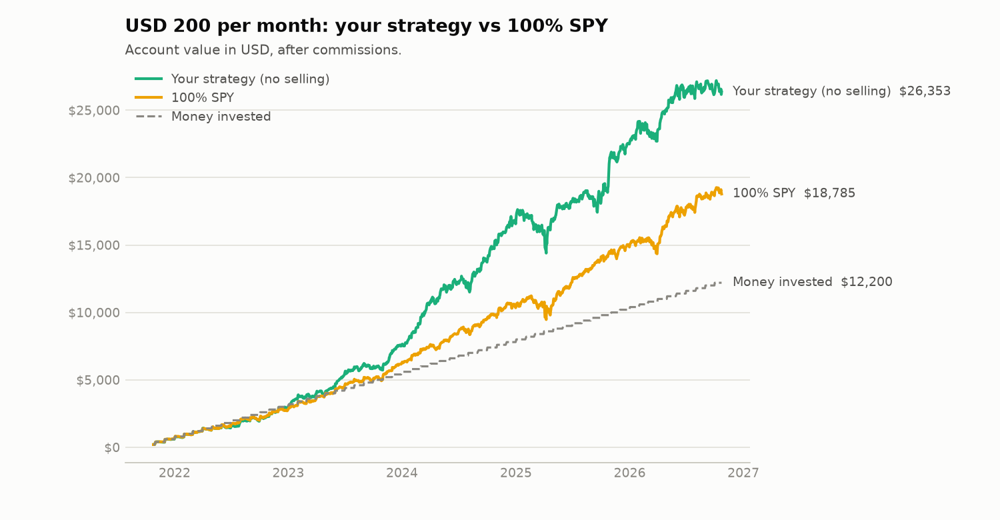

# Portfolio Quant Analysis — Argentine investor, measured in USD

**[English](#english) · [Español](#español)**

Quantitative analysis of two real investment portfolios held by an Argentine retail investor
(InvertirOnline): data pipeline with Argentine market sources, bond total-return reconstruction,
risk metrics, a monthly-contribution backtest with commissions, stress scenarios, robustness
checks and a forward-looking view from today's prices.



---

## English

### What it does

| Step | Module | Output |
|---|---|---|
| 1. Data | `src/data_loader.py`, `src/proxies.py` | Daily USD total-return series for 16 assets (5 years) |
| 2. Bond total return | `src/cashflows.py` | Coupon + amortization schedules, validated against ex-date price drops |
| 3. Metrics | `src/metrics.py` | CAGR, volatility, Sharpe, Sortino, max drawdown, correlations |
| 4. Backtest | `src/backtest.py` | USD 200/month, 60/40 split, "buy-the-underweight" vs full rebalance vs 100% SPY |
| 5. Robustness | `src/robustness.py` | Same analysis from Oct-2024 + country-risk context |
| 6. Stress scenarios | `src/scenarios.py` | Auto-detected worst drawdowns, loss per portfolio |
| 7. Outlook | `src/outlook.py` | Expected returns from today's yields/valuations + Monte Carlo of the plan |
| Report | `src/report.py` | `reports/portfolio_report.html` (interactive, Spanish) |

### Portfolios

**A — USD income (60% of each contribution):** AL35 15%, AO27 15%, ON YPF 2031 10%, ON Vista 2031 10%,
ON Tecpetrol 2030 10%, SPY 20%, IEUR 10%, FCI IOL Dólar Ahorro Plus 10%.
**B — Growth (40%):** QQQ 20%, GOOGL 10%, NVDA 10%, TSM 10%, NU 10%, VIST 15%, BMA 15%, dual CER/TAMAR bond TXMD9 10%.

CEDEARs are analyzed through their US-listed underlying, in USD.

### Key results (Oct-2021 → Oct-2026)

| | CAGR | Volatility | Sharpe | Max drawdown |
|---|---|---|---|---|
| A (income) | 14.7% | 16.7% | 0.68 | -36.7% |
| B (growth) | 38.9% | 26.2% | 1.24 | -31.7% |
| Combined 60/40 | 24.3% | 18.3% | 1.07 | -32.7% |
| SPY | 12.3% | 17.2% | 0.54 | -24.5% |

| Backtest, USD 200/month (USD 12,200 invested) | Final value | Money-weighted return | Fees |
|---|---|---|---|
| Strategy (buy underweights, never sell) | USD 26,353 | 31.1% | USD 72 |
| Full rebalance | USD 26,432 | 31.2% | USD 229 |
| 100% SPY | USD 18,785 | 17.2% | USD 79 |

**But:**
- **Robustness:** starting Oct-2024 the strategy and SPY end up roughly even (17.5% vs 16.5% money-weighted).
- **Hindsight bias:** assets were chosen in 2026 knowing the winners (NVDA, VIST), and the window starts
  with Argentine country risk at 1,667 bps (peak 2,913) versus ~700 today. That compression cannot repeat.
  **The historical results are an optimistic ceiling, not an expectation.**
- **From today's prices** the 60/40 has an expected return of ~6.5% per year, about the same as SPY.
  AL35 (12.7% yield) is most of portfolio A's return; AO27 yields 2.6%, below US T-bills.

### Methodology

- **Bond total return.** data912 prices are price-only, per 100 of original face value; the price drops
  on the ex-date (last trading day before payment). The total-return index is
  `TR_t = TR_{t-1} × (P_t + CF_t) / P_{t-1}`, with cash flows from the bond's coupon/amortization schedule,
  reinvested in the same bond. Validation: on 8-Jan-2025, AL30D fell 8.35 for a scheduled flow of 8.36.
  Price-only, AL30D would show 9% per year instead of 24%.
- **Proxies** (no public history): AO27 → AL30D total return; ONs → 50% CEMB + 50% AL30D (base),
  CEMB (pessimistic), EMB (sensitivity); TXMD9 → synthetic monthly max(CER, TAMAR) accrual converted to USD at
  CCL; FCI → real NAV from Nov-2024, BIL before.
- **Metrics:** daily returns for volatility/Sharpe (risk-free = 13-week T-bill, ^IRX); **weekly** returns
  for correlations (Argentine and US holidays differ).
- **Backtest:** contribution on the first trading day of each month; 0.65% commission per trade
  (0.5% + VAT + market fees) on bonds, ONs, CEDEARs and stocks, 0% on the FCI. NU (IPO Dec-2021)
  gets its weight redistributed across B until it trades. Money-weighted (XIRR) and time-weighted returns.
- **Outlook:** bonds → yield to maturity at today's price (own calculation, cross-checked with Rava);
  ETFs → earnings yield + 2.5% inflation; stocks → CAPM with 5-year weekly betas; TXMD9 → real peso yield,
  floored at 0% by the CER leg; FCI → last 26 weeks. Covariance from the last 2 years, with AO27's
  volatility rescaled by duration. Monte Carlo (10,000 paths, lognormal) for the 5-year plan.

### Limitations

- AL30 is longer and more volatile than AO27 (matures 2027), so **the proxy overstates AO27's volatility and drawdowns**.
- ON proxies are not the actual bonds; the three ONs share one proxy (their mutual correlation of ~1 is an artifact).
- The synthetic TXMD9 has no mark-to-market risk, so its volatility is understated.
- FCI data has gaps (interpolated); CEDEAR/CCL gap and taxes are ignored.
- Expected returns are simple building blocks, not forecasts. Bond yields are a ceiling (they assume no default).
- Past performance does not guarantee future results. This is not investment advice.

### How to run

```bash
python -m venv .venv
.venv\Scripts\activate        # Windows  (source .venv/bin/activate on macOS/Linux)
pip install -r requirements.txt
python main.py                # uses cached data in data/raw
python main.py --refresh      # re-downloads everything (prices, live bond quotes, valuations)
pytest                        # unit tests
```

The report is written to `reports/portfolio_report.html`. Weights, commissions, proxies and the
analysis window are in `src/config.py`.

### Project structure

```
├── main.py                 pipeline entry point
├── src/
│   ├── config.py           weights, sources, proxies, commissions
│   ├── data_loader.py      yfinance, data912, ArgentinaDatos, BCRA (cached)
│   ├── cashflows.py        bond schedules + total-return index
│   ├── proxies.py          splicing, ON blend, synthetic dual bond, FCI
│   ├── metrics.py          portfolio construction and risk metrics
│   ├── backtest.py         monthly-contribution backtest with commissions
│   ├── robustness.py       sub-period analysis, country-risk context
│   ├── scenarios.py        drawdown-episode detection and stress table
│   ├── outlook.py          yields, expected returns, Monte Carlo
│   ├── figures.py          static PNG charts
│   ├── report.py           HTML report (Plotly + Jinja2)
│   └── templates/
├── notebooks/analysis.ipynb
├── data/raw, data/processed   (see data/README.md)
├── reports/                portfolio_report.html, figures/, tables/
└── tests/
```

**Data sources:** yfinance · [data912.com](https://data912.com) · [ArgentinaDatos](https://argentinadatos.com) (CAFCI, CCL, EMBI)
· [BCRA API](https://www.bcra.gob.ar/BCRAyVos/catalogo-de-APIs-banco-central.asp) · Rava Bursátil (bond cash-flow schedules).

---

## Español

### Qué hace

Analiza dos portafolios reales de un inversor argentino en InvertirOnline, todo medido en dólares:
arma las series de datos con fuentes del mercado local, reconstruye el retorno total de los bonos
(cupones y amortizaciones), calcula métricas de riesgo y hace un backtest de aportes mensuales con
comisiones. También mide las peores caídas, prueba la robustez de los resultados y estima qué cabe
esperar desde los precios de hoy.

### Portafolios

**A — Renta en dólares (60% de cada aporte):** AL35 15%, AO27 15%, ON YPF 2031 10%, ON Vista 2031 10%,
ON Tecpetrol 2030 10%, SPY 20%, IEUR 10%, FCI IOL Dólar Ahorro Plus 10%.
**B — Crecimiento (40%):** QQQ 20%, GOOGL 10%, NVDA 10%, TSM 10%, NU 10%, VIST 15%, BMA 15%, bono dual CER/TAMAR TXMD9 10%.

Los CEDEARs se analizan por su activo subyacente en EE.UU., en dólares.

### Resultados principales (oct-2021 → oct-2026)

- **Con USD 200 por mes** (USD 12.200 aportados), la estrategia terminaría en **USD 26.353**, contra USD 18.785 con todo en SPY.
  El rendimiento anual de tu dinero fue de 31,1%, contra 17,2%.
- **Aportar sin vender** rinde casi igual que el rebalanceo completo (USD 26.432) y paga un tercio de las comisiones.
- **Más riesgo argentino:** en 2022 el combinado cayó 28%, más que SPY. A y B tienen una correlación de 0,67.
- **Robustez:** desde oct-2024 la estrategia y SPY quedan prácticamente empatados (17,5% contra 16,5%).
- **Sesgo de retrospectiva:** los activos se eligieron en 2026 conociendo a los ganadores (NVDA, VIST). Además,
  el período arranca con el riesgo país en 1.667 pb (máximo de 2.913) y termina en ~700, una compresión que no se
  puede repetir. **Los resultados históricos son un techo optimista, no una expectativa.**
- **Desde los precios de hoy**, el 60/40 tiene un rendimiento esperado de ~6,5% anual, parecido al de SPY.
  AL35 (TIR 12,7%) aporta casi todo el rendimiento de A, y AO27 rinde 2,6%, menos que una letra del Tesoro de EE.UU.

### Metodología

- **Retorno total de bonos:** data912 publica solo el precio (por cada 100 de valor nominal original), y el precio cae
  en la fecha ex. Se reconstruye `TR_t = TR_{t-1} × (P_t + flujo_t) / P_{t-1}` con los flujos de cupón y amortización,
  reinvertidos en el mismo bono. Validación: el 8-ene-2025, AL30D cayó 8,35 y el flujo programado era 8,36.
  Solo con el precio, AL30D rendiría 9% anual en lugar de 24%.
- **Proxies:** AO27 → AL30D con retorno total. ONs → 50% CEMB + 50% AL30D (base), solo CEMB (pesimista) y EMB (sensibilidad).
  TXMD9 → bono sintético que cada mes rinde el máximo entre CER y TAMAR, pasado a USD con el CCL. FCI → cuotaparte real
  desde nov-2024 y BIL antes.
- **Backtest:** aporte el primer día hábil de cada mes. Comisión de 0,65% por operación (0,5% + IVA + derechos de mercado)
  y 0% en el FCI. El peso de NU se reparte entre el resto de B hasta su salida a bolsa (dic-2021).
- **Expectativas:** para bonos, la TIR actual (cálculo propio, controlado contra Rava). Para ETFs, el rendimiento de las
  ganancias (1/PER) + 2,5% de inflación. Para acciones, CAPM. Para TXMD9, el rendimiento real en pesos con piso 0%.
  Para el FCI, sus últimas 26 semanas. Además, una simulación Monte Carlo del plan a 5 años.

### Supuestos y limitaciones

- AL30 es más largo y volátil que AO27 (vence en 2027), así que **el proxy sobreestima la volatilidad y las caídas de AO27**.
- Las ONs usan un proxy común, así que su correlación entre sí (~1) es un artefacto del método.
- El TXMD9 sintético no tiene riesgo de precio de mercado, así que subestima su volatilidad.
- El FCI tiene huecos de datos (interpolados). No se consideran la brecha CEDEAR/CCL ni los impuestos.
- Las expectativas son supuestos simples, no pronósticos. La TIR de un bono es un máximo: supone que el emisor paga todo.
- Rendimientos pasados no garantizan rendimientos futuros. No es asesoramiento financiero.

### Cómo correrlo

```bash
python -m venv .venv
.venv\Scripts\activate
pip install -r requirements.txt
python main.py               # usa los datos guardados en data/raw
python main.py --refresh     # vuelve a descargar todo
pytest                       # tests
```

El informe queda en `reports/portfolio_report.html`. Los pesos, las comisiones, los proxies y el período
se cambian en `src/config.py`.
